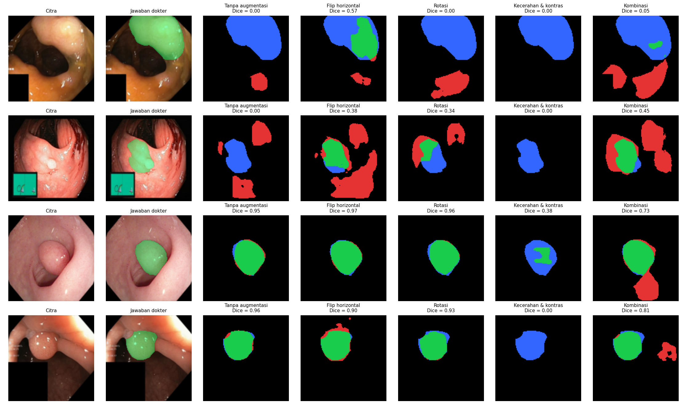

# Segmentasi Polip pada Citra Kolonoskopi dengan U-Net

<!--
  TEMPLATE LAPORAN — Tugas P10 Kecerdasan Buatan (BM25-41204), Teknik Biomedis ITERA.
  Petunjuk lengkap: https://mctm.web.id/ai-bm/tugas

  Cara memakai:
  - Ganti semua teks yang diawali "✍️" dengan tulisan kelompokmu, lalu hapus tanda ✍️-nya.
  - Blok komentar seperti ini adalah petunjuk; tidak tampil di GitHub. Boleh dihapus.
  - Gambar diambil dari folder hasil/ yang dibuat otomatis oleh notebook.
  - Jangan hapus judul-judul bagian (##).
-->

**Tugas P10 — Kecerdasan Buatan (BM25-41204), Teknik Biomedis ITERA**

## Anggota kelompok

| Nama | NIM | Username GitHub | Kontribusi utama |
|---|---|---|---|
| Rizka Putri Handayani | 123430017 | rizkaputrihandayanj-ui |  menjalankan eksperimen, menulis bagian 3, menulis bagian 4 |
| ✍️ | ✍️ | ✍️ | ✍️ |

## 1. Pertanyaan

Augmentasi apa yang membantu U-Net menemukan polip pada citra kolonoskopi, dan augmentasi apa yang tidak? Kenapa?

## 2. Data & pengaturan

<!-- Isi dari Bagian 2 notebook. Pastikan CEPAT = False untuk hasil akhir. -->

- Dataset: Kvasir-SEG (1000 citra kolonoskopi + mask polip), diperkecil ke 128 × 128 piksel.
- Data uji: 200 citra (tetap). Data latih: 800 citra per ulangan.
- Model: U-Net mini (±0,5 juta parameter), 30 epoch, 3 ulangan per skenario.
- Dijalankan di: Google Colab T4.


## 3. Skenario augmentasi & hipotesis

<!-- Tulis bagian ini SEBELUM menjalankan eksperimen. Commit dulu, baru jalankan.
     Alasan klinis = kenapa variasi ini mungkin (atau tidak mungkin) terjadi pada kolonoskopi sungguhan. -->

| Skenario | Augmentasi (kode) | Alasan klinis | Hipotesis: Dice naik/turun/sama? |
|---|---|---|---|
| Tanpa augmentasi | — | Pembanding | — |
| Flip horizontal | `v2.RandomHorizontalFlip(p=0.5)` | Polip dapat terlihat dari berbagai orientasi akibat perubahan posisi dan sudut pengambilan gambar kamera kolonoskopi. | Naik |
| Rotasi | `v2.RandomRotation(degrees=15)` | Posisi dan orientasi citra dapat berubah selama pemeriksaan akibat pergerakan kamera kolonoskopi. | Naik |
| Kecerahan & kontras | `v2.ColorJitter(brightness=0.2, contrast=0.2)` | Intensitas pencahayaan dan kontras citra dapat berbeda akibat kondisi pencahayaan serta jarak kamera terhadap jaringan.| Naik |
| Kombinasi | `Flip horizontal + Rotasi + Kecerahan & kontras` | Menggabungkan variasi orientasi dan pencahayaan untuk meningkatkan kemampuan model dalam mengenali polip pada kondisi citra yang beragam.| Naik |
Contoh augmentasi yang dicoba:


<!-- Ganti nama file sesuai skenario kalian (lihat isi folder hasil/). -->

## 4. Hasil

<!-- Tempel isi hasil/ringkasan.md di sini. -->

| Skenario | Dice (rata-rata ± sb) | IoU (rata-rata ± sb) | Dice tiap ulangan |
|---|---|---|---|
| Tanpa augmentasi | 0.535 ± 0.078 | 0.429 ± 0.063 | 0.552, 0.621, 0.431 |
| Flip horizontal | 0.574 ± 0.045 | 0.463 ± 0.036 | 0.593, 0.617, 0.511 |
| Rotasi | 0.562 ± 0.059 | 0.455 ± 0.053 | 0.485, 0.572, 0.628 |
| Kecerahan & kontras | 0.438 ± 0.102 | 0.345 ± 0.088 | 0.399, 0.577, 0.337 |
| Kombinasi | 0.543 ± 0.041 | 0.432 ± 0.036 | 0.562, 0.486, 0.582 | 

(https://colab.research.google.com/drive/1SA3Hcq02cK_OzUxZQH8k8mBtKLuKPYcD#scrollTo=14dd4f45&fullscreenOutput=true)

## 5. Analisis peta kesalahan



<!-- Hijau = benar, merah = false positive, biru = false negative.
     Pertanyaan pemandu: Polip seperti apa yang sering terlewat (kecil? datar? warna mirip dinding usus?)
     Apa yang sering dikira polip padahal bukan? Apakah augmentasi memperbaiki kasus sulit? -->

✍️

## 6. Pembahasan & kesimpulan

<!-- Bandingkan hasil dengan hipotesis di Bagian 3. Hipotesis yang ternyata salah tetap bernilai,
     asalkan dijelaskan kenapa. Perbedaan kecil (lebih kecil dari simpangan baku) belum tentu berarti. -->

✍️

## 7. Pembagian kerja

<!-- Siapa mengerjakan apa. Penilaian proses kerja dilihat dari riwayat commit tiap anggota. -->

✍️

## 8. Penggunaan AI

<!-- Wajib diisi, walau tidak memakai AI (tulis "Tidak memakai AI").
     Contoh: "Claude Code (CLI) untuk menulis skenario augmentasi dan memperbaiki error di Bagian 4.
     Draf Bagian 6 ditulis sendiri, lalu dirapikan bahasanya dengan bantuan AI." -->

✍️

## Cara menjalankan ulang

```bash
uv sync
uv run jupyter lab segmentasi_polip.ipynb
```

Atau buka notebook di Google Colab (Runtime → Change runtime type → T4 GPU).

## Referensi

- Jha, D., dkk. (2020). Kvasir-SEG: A Segmented Polyp Dataset. *MultiMedia Modeling (MMM 2020)*, 451–462.
- Ronneberger, O., Fischer, P., & Brox, T. (2015). U-Net: Convolutional Networks for Biomedical Image Segmentation. *MICCAI*. arXiv:1505.04597.
- ✍️ tambahkan referensi lain yang kalian pakai
